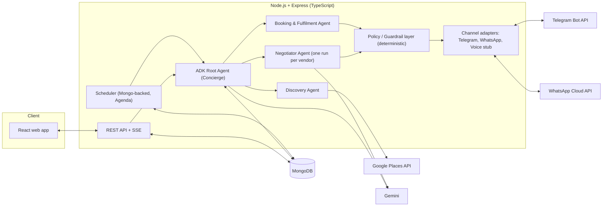
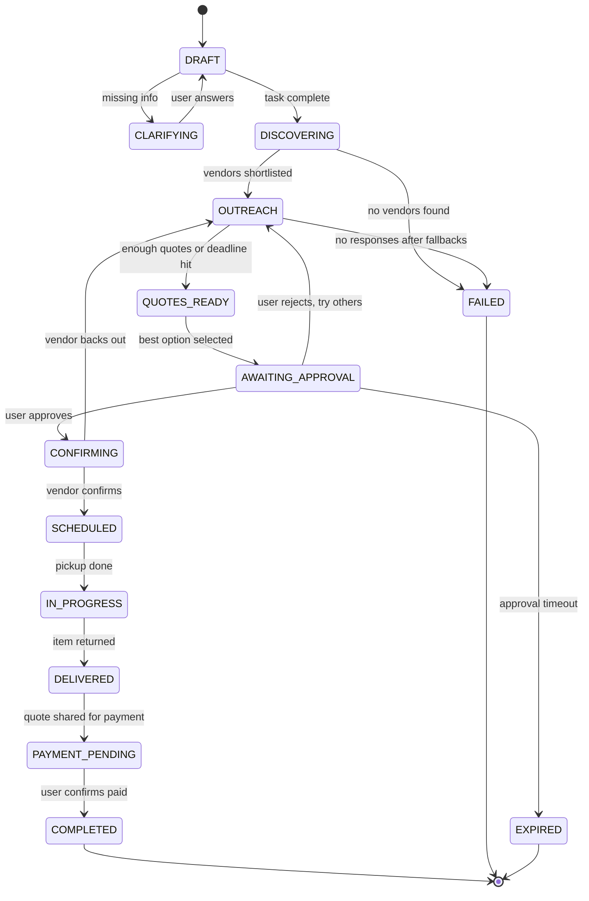

# Concierge Agent: Product & Technical Spec

**Status:** Draft v0.1  
**Scope of this version:** v1 = local errands (laundry, ironing, repairs, deliveries)  
**Stack constraint:** MERN (MongoDB, Express, React, Node.js). This is a hard requirement. Nothing in this spec introduces a non-MERN service.

---

## 1. Overview

A personal concierge powered by an agentic system. The user describes an errand in plain language ("I want my shirt ironed, someone should pick it up and drop it back"). The system:

1. Turns the request into a structured task, asking clarifying questions if needed.
2. Discovers real nearby vendors.
3. Contacts several vendors on the user's behalf, asks for quotes, and negotiates within limits the user sets.
4. Presents the best options and the agreed quote to the user.
5. Books only after the user approves.
6. Tracks pickup, service and drop-off, and prompts the user to pay the vendor directly (UPI/cash).

The agent never moves money, never holds payment credentials, and never commits to a price or booking without an explicit approval from the user.

### Goals (v1)

- End-to-end flow for one errand category family (laundry / ironing / dry cleaning with pickup and drop), then generalise to other local errands.
- Real vendors, real conversations, real bookings.
- Human approval gate before any commitment.
- Full audit trail of everything the agent said and did.

### Non-goals (v1)

- Trip itineraries (planned for a later version, reusing the same discovery, outreach and booking engine).
- In-app payments, escrow or payouts. The user pays the vendor directly.
- Fully autonomous AI voice calls (phone is a fallback channel only; see 6.4).
- Native mobile apps (responsive web only).

---

## 2. Key decisions (locked)

| Area | Decision |
|---|---|
| Stack | MERN, TypeScript throughout |
| Agent framework | Google ADK (TypeScript SDK), running in-process inside the Node backend |
| LLM | Gemini via ADK; model name configurable via env |
| v1 scope | Local errands only |
| Vendor discovery | Google Places API (New) |
| Vendor outreach | Agent initiates contact with discovered vendors; Telegram bot is the conversation channel; WhatsApp / phone are fallbacks |
| Payments | User pays the vendor directly (UPI/cash) after the agent shares the agreed quote and the user approves |
| Autonomy | Bounded. Approval gate enforced in code, not in the prompt |

> **ADK note:** ADK is Python-first, and its TypeScript SDK is newer. Verify the TS SDK supports what we need (sub-agents, function tools, custom session service, tracing) before M0 ends. If a capability is missing, implement that piece directly with the Gemini SDK in Node. Do **not** add a Python service, since that would break the MERN requirement.

---

## 3. Critical constraint: Telegram bots cannot cold-message

A Telegram bot **cannot start a conversation** with a user who has not first opened the bot (sent `/start` or a message). A vendor discovered via Google Places has a phone number, not a Telegram chat ID. So "the agent cold-messages vendors on Telegram" is not possible as stated.

**Design response (adopted in this spec):**

1. Discovery returns vendor phone numbers (and sometimes a website).
2. First touch goes out on a channel that *can* be initiated: **WhatsApp Business (Cloud API) template message**, or SMS, containing a short intro and a deep link: `https://t.me/<BOT_USERNAME>?start=<inviteToken>`.
3. When the vendor taps the link and presses Start, the bot receives `/start <inviteToken>`, links `chat_id` to the vendor record, and the Telegram conversation begins.
4. If the vendor does not join Telegram within a timeout, the conversation continues on WhatsApp (same agent logic, different adapter).
5. If neither works, fall back to a human-assisted call (see 6.4).

**Explicitly rejected:** using a Telegram *user account* (MTProto userbot) to cold-message vendors. It violates Telegram's terms, gets accounts banned, and is spam-adjacent.

Because of this, channels are abstracted behind an adapter interface (see 6.1) so the agent logic is channel-agnostic.

---

## 4. System architecture



### 4.1 Event-driven agent runs

Agents are **not** long-running loops waiting on vendors. Vendors reply in minutes or hours. Each agent run is a short turn triggered by an event:

| Event | Source | Triggers |
|---|---|---|
| `task.created` | User message | Intake / clarification |
| `task.ready` | Intake complete | Discovery |
| `vendors.shortlisted` | Discovery | Fan-out outreach |
| `vendor.message.received` | Telegram/WhatsApp webhook | Negotiator turn for that vendor |
| `timer.fired` | Scheduler | Follow-up, timeout, escalate |
| `approval.granted` / `approval.rejected` | User | Booking confirmation / replan |
| `fulfilment.update` | Vendor or user | Status update, payment prompt |

Session state is persisted in MongoDB. Implement a `MongoSessionService` against ADK's session-service interface (or equivalent), so a run can resume from stored history.

### 4.2 Agents

| Agent | Responsibility | Tools |
|---|---|---|
| **Concierge (root)** | Talks to the user, owns the task state machine, delegates | `update_task`, `ask_user`, `notify_user`, sub-agents |
| **Discovery** | Finds and ranks nearby vendors for the category | `search_places`, `get_place_details`, `rank_vendors` |
| **Negotiator** | One conversation with one vendor: ask for quote, availability, pickup/drop terms, negotiate | `send_vendor_message`, `record_quote`, `schedule_followup`, `close_conversation` |
| **Booking & Fulfilment** | After approval: confirm with vendor, schedule pickup/drop, track status, prompt payment | `confirm_booking` (guarded), `update_fulfilment`, `request_payment_confirmation` |

Negotiators for different vendors run in parallel (one run per vendor conversation). They do not see each other's conversations; the root agent compares recorded quotes.

---

## 5. Task lifecycle (state machine)



Any non-terminal state can transition to `CANCELLED` by user request. Cancelling after `SCHEDULED` triggers a cancellation message to the vendor.

---

## 6. Vendor communication

### 6.1 Channel adapter interface

```ts
interface VendorChannel {
  id: "telegram" | "whatsapp" | "voice";
  canInitiate(vendor: Vendor): boolean;        // telegram: only if linked
  send(vendor: Vendor, msg: OutboundMessage): Promise<SendResult>;
  parseInbound(raw: unknown): InboundMessage;  // webhook payload -> normalised
}
```

All inbound and outbound messages are normalised and stored in `messages`, regardless of channel.

### 6.2 Telegram (primary conversation channel)

- Library: grammY or Telegraf, **webhook mode** on Express.
- `/start <inviteToken>` links a vendor.
- Vendor commands: `/stop` (opt out, honoured immediately and permanently), `/help`.
- Inline keyboards for structured replies where useful (e.g., pickup slot choices).

### 6.3 WhatsApp (first touch + fallback)

- Meta WhatsApp Cloud API.
- Business-initiated messages require **pre-approved templates**. Template 1 is the intro with the Telegram deep link; Template 2 is a short follow-up.
- Within the 24-hour session window after the vendor replies, free-form messages are allowed and the conversation can continue entirely on WhatsApp.
- Check Meta's current policy on messaging businesses that have not opted in before launching a pilot.

### 6.4 Phone (fallback, v1 = human-assisted)

If a vendor is unreachable on messaging channels, the app shows the user a **click-to-call card** with a short scripted brief ("Ask: price for N shirts, pickup and drop to <locality>, by <time>") and a form to log the outcome. An AI voice channel is a future adapter, not v1.

### 6.5 Disclosure and conduct

- First message always states that this is an AI assistant acting for a customer, and what the request is.
- Polite, concise, no pressure tactics, no deception.
- Rate limits per vendor and per task (e.g., max 1 unanswered nudge per 2 hours, max 3 nudges total).
- Honour opt-outs globally across tasks.
- Language: detect the vendor's language and reply in it where possible (English, Hindi, Hinglish, etc.), keeping the stored canonical summary in English.

### 6.6 First-touch message (template draft)

> Hi, this is an AI assistant messaging on behalf of a customer nearby. They'd like **{service}** with pickup and drop at **{locality}**. Could you share your price and earliest pickup slot? Reply here, or continue on Telegram: {deepLink}. Reply STOP to opt out.

---

## 7. Negotiation policy

Negotiation is bounded autonomy. Limits live in code (`PolicyConfig`) and are enforced by the guardrail layer, not by prompt wording.

**The agent may:**

- Ask for itemised pricing, pickup/drop fees, turnaround time, and cancellation terms.
- Ask for a discount or a pickup/drop fee waiver.
- Truthfully tell a vendor that it has received a lower quote **only if that is true**, without naming the other vendor.
- Propose alternative pickup windows within the user's constraints.
- Run up to `maxRounds` (default 3) per vendor.

**The agent may not:**

- Confirm a booking or agree to a final price without an `Approval` record (see 9).
- Exceed the user's budget ceiling.
- Invent competing quotes or claim facts it does not have.
- Share the user's full address, phone number or name before the booking is approved. Quotes use locality / pincode only. Full address is released after approval.
- Agree to advance payment. Any advance-payment request is escalated to the user.
- Accept terms that conflict with the user's constraints (time window, service type).

**Quote normalisation:** every quote is stored as structured data so the root agent can compare vendors:

```ts
interface Quote {
  vendorId: ObjectId;
  taskId: ObjectId;
  lineItems: { label: string; qty: number; unitPrice: number }[];
  pickupFee: number;
  dropFee: number;
  total: number;
  currency: string;               // default INR
  pickupSlots: { start: Date; end: Date }[];
  turnaroundHours: number;
  cancellationTerms?: string;
  validUntil?: Date;
  rawMessageIds: ObjectId[];      // provenance
  status: "proposed" | "countered" | "accepted_by_vendor" | "expired" | "rejected";
}
```

---

## 8. Payments (v1)

No money moves through the system. The agent never sees card numbers, UPI PINs or bank details.

1. After the user approves a quote, the booking is confirmed with the vendor.
2. When the service is delivered, the app shows a **payment card**: vendor name, agreed total, and the vendor's UPI ID or QR (as supplied by the vendor in chat).
3. The app can generate a UPI deep link (`upi://pay?pa=...&am=...&tn=...`) so the user pays in their own UPI app, or marks it as cash.
4. The user taps **"I've paid"** (optionally with a reference). The vendor may also confirm receipt in chat.
5. Task moves to `COMPLETED`.

**Safeguards:**

- The agreed total in the approval record is the reference amount. Show a warning if the vendor asks for a different amount at payment time.
- Vendor-supplied UPI IDs are shown with a "verify the payee name in your UPI app before paying" notice.
- Advance payment requests are never auto-accepted; they surface to the user with an explicit warning.

---

## 9. Human approval gate

Approval is a first-class database object, and the only way to unlock booking.

```ts
interface Approval {
  _id: ObjectId;
  taskId: ObjectId;
  quoteId: ObjectId;
  quoteSnapshot: Quote;          // frozen copy shown to the user
  status: "pending" | "granted" | "rejected" | "expired";
  decidedBy?: ObjectId;          // user
  decidedAt?: Date;
  expiresAt: Date;
}
```

The `confirm_booking` tool performs this check in code before doing anything:

```ts
async function confirmBooking({ taskId, quoteId }: Args) {
  const approval = await Approvals.findOne({
    taskId, quoteId, status: "granted", expiresAt: { $gt: new Date() },
  });
  if (!approval) throw new PolicyError("NO_VALID_APPROVAL");
  if (!quotesMatch(approval.quoteSnapshot, await Quotes.findById(quoteId)))
    throw new PolicyError("QUOTE_CHANGED_SINCE_APPROVAL");
  // proceed: message vendor to confirm, create Booking
}
```

If the vendor changes the price, slots or terms after approval, the booking is paused and a new approval is requested.

---

## 10. Data model (MongoDB / Mongoose)

| Collection | Purpose | Key fields |
|---|---|---|
| `users` | Account and preferences | email, name, defaultAddresses[], budgetDefaults, language |
| `tasks` | One errand | userId, category, rawRequest, structured{items, timeWindow, location, budgetMax, notes}, state, createdAt |
| `vendors` | Discovered vendors (shared across users) | placeId, name, phone, address, geo (2dsphere), rating, categories[], optedOut, channels{telegramChatId?, whatsappId?} |
| `vendorInvites` | Deep-link tokens | vendorId, taskId, token, expiresAt, usedAt |
| `conversations` | One per (task, vendor) | taskId, vendorId, channel, state, roundCount, lastActivityAt |
| `messages` | Normalised transcript | conversationId, direction, channel, text, translatedText?, ts, externalId |
| `quotes` | Structured quotes | see section 7 |
| `approvals` | User approval records | see section 9 |
| `bookings` | Confirmed bookings | taskId, vendorId, quoteId, pickupSlot, dropSlot, status |
| `payments` | User-reported payments (no money handled) | bookingId, amount, method, reference?, confirmedByUser, confirmedByVendor? |
| `auditLog` | Append-only record of agent actions and guardrail decisions | taskId, actor, action, payload, ts |
| `agentSessions` | ADK session state | sessionId, taskId, agent, state, history |
| `jobs` | Agenda scheduler collection | managed by Agenda |

Indexes: `vendors.geo` (2dsphere), `vendors.placeId` (unique), `conversations(taskId, vendorId)` (unique), `messages(conversationId, ts)`, `vendorInvites.token` (unique, TTL on `expiresAt`).

---

## 11. Backend API (Express)

All user endpoints require auth (JWT in an httpOnly cookie).

| Method | Path | Purpose |
|---|---|---|
| POST | `/auth/register`, `/auth/login` | Auth |
| POST | `/tasks` | Create task from natural-language request |
| GET | `/tasks`, `/tasks/:id` | List / detail (includes timeline) |
| POST | `/tasks/:id/messages` | User replies to the agent (clarifications) |
| GET | `/tasks/:id/quotes` | Normalised quotes for comparison |
| POST | `/approvals/:id/grant` \| `/reject` | Approval decision |
| POST | `/tasks/:id/payment-confirmation` | "I've paid" |
| POST | `/tasks/:id/cancel` | Cancel |
| GET | `/tasks/:id/events` | **SSE** stream of live timeline updates |
| POST | `/webhooks/telegram` | Telegram updates (secret token verified) |
| GET/POST | `/webhooks/whatsapp` | WhatsApp verification + inbound (signature verified) |

Real-time to the browser uses Server-Sent Events (or Socket.IO if bidirectional is needed later).

---

## 12. Agent tools (ADK function tools)

| Tool | Description | Guarded? |
|---|---|---|
| `search_places(query, lat, lng, radius)` | Google Places Nearby/Text Search | No |
| `get_place_details(placeId)` | Phone, hours, rating | No |
| `rank_vendors(vendors, task)` | Deterministic scoring: distance, rating, open hours, category fit | No |
| `start_outreach(vendorId, taskId)` | Creates invite + sends first-touch template | Yes (rate limit, opt-out check) |
| `send_vendor_message(conversationId, text)` | Sends on the active channel | Yes (policy filter: no PII leak, no commitments) |
| `record_quote(conversationId, quote)` | Persists structured quote | Validation |
| `schedule_followup(conversationId, delay)` | Creates a timer job | Yes (nudge limits) |
| `request_user_approval(taskId, quoteId)` | Creates `Approval`, notifies user | No |
| `confirm_booking(taskId, quoteId)` | Confirms with vendor | **Yes: requires granted approval** |
| `update_fulfilment(bookingId, status)` | Pickup / in-progress / delivered | Validation |
| `notify_user(taskId, message)` | Push into the app timeline | No |

**Guardrail layer** wraps every outbound tool call. It checks opt-outs, rate limits, PII redaction (address, phone, full name), budget ceilings, and approval prerequisites. A blocked call returns a structured error to the agent and is logged in `auditLog`.

---

## 13. Frontend (React)

Vite + React + TypeScript. Suggested libs: React Router, TanStack Query, Tailwind.

**Screens**

1. **New request / chat**: conversational input; the agent asks clarifying questions inline.
2. **Task detail**: live timeline (discovery, vendors contacted, replies, quotes), driven by SSE.
3. **Quote comparison**: cards per vendor (total, fees, slots, rating, distance), best pick highlighted with reasoning.
4. **Approval modal**: frozen quote snapshot, what will be shared with the vendor, Approve / Reject / Ask agent to negotiate further.
5. **Fulfilment tracker**: scheduled, picked up, in progress, delivered.
6. **Payment card**: amount, UPI link / QR, "I've paid".
7. **Manual call card** (phone fallback).
8. **Settings**: saved addresses, default budget ceiling, language, notification preferences.

---

## 14. Safety, privacy and abuse

- **Prompt injection:** vendor messages are untrusted. They are passed to the model as quoted data, never as instructions. The model cannot grant approvals or change policy through conversation, because those paths are enforced in code.
- **PII minimisation:** vendors only receive what they need at each stage (locality before approval, full address after).
- **Consent and opt-out:** honour `/stop` and STOP replies permanently; keep a global suppression list.
- **Platform compliance:** follow Telegram Bot ToS and WhatsApp Business messaging policy (templates, opt-in/opt-out handling, quality rating).
- **Data protection:** encrypt at rest and in transit, field-level encryption for addresses and phone numbers, retention policy for transcripts, user data export and deletion. Comply with the data-protection law that applies in the target region.
- **Secrets:** bot tokens, WhatsApp tokens and API keys in env/secret manager only; webhook signature and secret-token verification on every webhook.
- **Kill switch:** a config flag that pauses all outbound vendor messaging globally.
- **Abuse:** per-user daily task limits and per-vendor contact caps so the system cannot be used to spam local businesses.

---

## 15. Observability and evaluation

- Structured JSON logs with `taskId`, `conversationId`, `runId` on every line.
- ADK / OpenTelemetry tracing for agent runs and tool calls where supported.
- `auditLog` is the source of truth for "what did the agent do and why".
- **Vendor simulator:** a scripted/LLM-driven fake vendor bot (cooperative, slow, rude, overpriced, advance-payment-seeking, non-English) used for automated end-to-end tests. This is how the negotiation and guardrails are tested without messaging real businesses.
- Eval set of transcripts with expected outcomes (correct quote extraction, no PII leak, no unapproved commitment).

**Metrics:** vendor response rate, time to first quote, quotes per task, booking success rate, average savings vs first quote, approval-to-booking conversion, guardrail block rate, user-reported issues.

---

## 16. Edge cases and failure handling

| Situation | Handling |
|---|---|
| No vendors found in radius | Expand radius once, then tell user and offer to adjust constraints |
| Vendor never joins Telegram | Move to WhatsApp; if still silent, offer manual call card |
| Fewer than N quotes by deadline | Present what exists, with a note |
| Vendor changes price after approval | Pause booking, new approval required |
| Ambiguous vendor reply | Agent asks a clarifying question; after 2 failed attempts, flag for user |
| Vendor asks for advance payment | Escalate to user with warning; never auto-accept |
| Vendor no-show at pickup | Notify user, message vendor, offer re-plan with next-best quote |
| Item damaged / dispute | Out of scope for automation; surface transcript and vendor contact to the user |
| User cancels mid-negotiation | Send polite cancellation to all active vendors |
| Vendor opts out | Mark `optedOut`, never contact again |
| Vendor replies in an unsupported language | Store original, attempt translation, flag low confidence |
| Duplicate / out-of-order webhooks | Idempotency on `externalId` |

---

## 17. Suggested repo layout (MERN monorepo)

```
/concierge
  /client                  # React (Vite)
    /src/pages, /components, /hooks, /api
  /server                  # Node + Express (TypeScript)
    /src
      /agents              # root, discovery, negotiator, booking (ADK)
      /tools               # ADK function tools
      /guardrails          # policy engine, PII redaction, rate limits
      /channels            # telegram.ts, whatsapp.ts, voice.stub.ts
      /models              # Mongoose schemas
      /routes              # REST + SSE + webhooks
      /services            # places, quotes, scheduling, session service
      /jobs                # Agenda job definitions
      /sim                 # vendor simulator for tests
  /shared                  # shared TS types (Task, Quote, Approval, events)
  Spec.md
```

---

## 18. Configuration (env)

```
MONGODB_URI=
JWT_SECRET=
GEMINI_API_KEY=
GEMINI_MODEL=
GOOGLE_PLACES_API_KEY=
TELEGRAM_BOT_TOKEN=
TELEGRAM_BOT_USERNAME=
TELEGRAM_WEBHOOK_SECRET=
WHATSAPP_PHONE_NUMBER_ID=
WHATSAPP_ACCESS_TOKEN=
WHATSAPP_APP_SECRET=
WHATSAPP_VERIFY_TOKEN=
DEFAULT_CURRENCY=INR
OUTBOUND_MESSAGING_ENABLED=true   # kill switch
MAX_NEGOTIATION_ROUNDS=3
VENDORS_PER_TASK=5
APPROVAL_TTL_MINUTES=60
```

---

## 19. Milestones

| # | Milestone | Outcome |
|---|---|---|
| M0 | Skeleton | Monorepo, auth, Mongo models, ADK hello-agent in Node, TS SDK capability check |
| M1 | Intake + discovery | NL request to structured task; Places search and ranking; React chat + task timeline |
| M2 | Channels + simulator | Telegram bot with deep-link onboarding, WhatsApp template first touch, vendor simulator |
| M3 | Negotiation | Negotiator agent, quote extraction, policy engine, audit log |
| M4 | Approval + booking | Quote comparison UI, approval gate, guarded `confirm_booking` |
| M5 | Fulfilment + payment | Pickup/drop tracking, payment card with UPI link, completion flow |
| M6 | Hardening + pilot | Rate limits, privacy controls, tracing, closed pilot with a handful of real vendors and users |

---

## 20. Open questions

1. **Region and currency:** UPI implies India; confirm launch city/region (affects Places coverage, language support, WhatsApp template approval).
2. **WhatsApp account:** who owns the WhatsApp Business account and display name? Template approval takes time, so start early.
3. **Auth for users:** email/password, Google sign-in, or phone OTP?
4. **User notifications:** web-only, or also push / email / a user-facing Telegram bot for approvals?
5. **Vendor repeat business:** should vendors who respond well be remembered and prioritised across users?
6. **Ratings and feedback:** collect user feedback on each errand to improve ranking?
7. **ADK TypeScript maturity:** confirm feature coverage at M0 (see Section 2 note).
8. **Trip itineraries (future):** reuse discovery, outreach and approval engine; add itinerary planner agent and multi-vendor booking orchestration.
